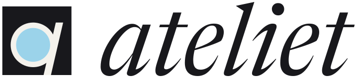

<h1>
  <picture>
    <source media="(prefers-color-scheme: dark)" srcset="brand/lockup-dark.svg">
    
  </picture>
</h1>

Um clone minimalista do Obsidian, com núcleo em **Rust**, que abre **o mesmo vault** que o Obsidian e roda os **plugins da comunidade do Obsidian sem modificação**.

- **Leve**: Tauri 2 + a webview nativa do sistema (WebKit no macOS), em vez de um Chromium embutido. O frontend tem cerca de 0,8 MB minificado, e as linguagens de código são carregadas sob demanda.
- **Compatível**: implementa a API pública `obsidian` (o contrato do `obsidian.d.ts`) e as APIs internas mais usadas pelos plugins populares.
- **Customizável**: temas, snippets CSS, atalhos e plugins são lidos de `.obsidian/`, as mesmas pastas e arquivos do Obsidian.

## Rodando

Requisitos: Rust (stable) e [Deno](https://deno.com) (só para empacotar o frontend; não precisa de Node). Na primeira compilação, o crate `ort` baixa o ONNX Runtime (usado pela busca de imagens) e o liga estaticamente ao binário. Sem acesso a esses binários, compile com `--no-default-features --features ort-dynamic` e aponte `ORT_DYLIB_PATH` para uma `libonnxruntime` instalada no sistema.

```sh
./build.sh            # empacota ui/ → dist/
cargo run -- ~/caminho/do/vault
```

Sem argumento, o Ateliet reabre o último vault ou mostra o seletor, que já lista os vaults conhecidos pelo Obsidian.

App instalável (macOS `.app`/`.dmg`, Windows `.msi`, Linux `.deb`/`.AppImage`):

```sh
cargo install tauri-cli --version "^2"
./build.sh && cargo tauri build
```

## Interface nativa (sem WebKit)

A interface está sendo migrada para uma versão nativa em Rust (`native/`, desenhada com egui). Ela não usa webview nem GTK e abre o mesmo vault, com as mesmas notas e configurações. O binário tem cerca de 14 MB, com a fonte Inter e os ícones Lucide embutidos, para que a aparência seja a mesma em qualquer sistema. O visual é claro e minimalista, com tema escuro opcional; a cor de destaque vem do vault, escurecida automaticamente quando é clara demais para texto.

```sh
cargo run -p ateliet-native --release -- ~/caminho/do/vault
sh native/bundle-macos.sh --install    # gera e instala "Ateliet Native.app"
```

Já funciona:
- **Notas**: editor com Live Preview por bloco (o bloco em edição vira texto e os outros aparecem renderizados), modo código-fonte e modo de leitura. Salvamento automático, abas reabertas por vault, propriedades do frontmatter.
- **Markdown do Obsidian**: wikilinks e embeds (notas, seções e imagens), tags, callouts dobráveis, realce, campos inline, tarefas com status personalizados que se marcam clicando, tabelas e código.
- **Ferramentas embutidas**: blocos `dataview`, `dataviewjs` e consultas inline, desenhados a partir do núcleo; Templater com as janelas de prompt e de escolha; calendário de notas diárias.
- **Navegação**: explorador de arquivos (criar, renomear, apagar), busca, favoritos, backlinks e links de saída, sumário, tags, paleta de comandos (Ctrl/Cmd+P), troca rápida de nota (Ctrl/Cmd+O) e os atalhos do `hotkeys.json`.
- **Modo imagens** (Ctrl/Cmd+Shift+I): mosaico de todas as imagens, coleções por pasta, busca por nome e por descrição (CLIP, baixado na primeira vez), imagens parecidas, visualizador com zoom e inserção na nota.
- **Storyboard**: arquivos `.storyboard` abrem num editor de desenho (lápis, caneta, pincel, marcador, borracha, conta-gotas), com quadros, reprodução, camadas com modos de mistura, papel de cebola, desfazer e exportação de PNG.
- **Scriptorium**: Biblioteca de livros (capa, números, meta, últimos 14 dias, estante por série), painel do Manuscrito com status, partes e reordenação por arrastar, criação de livros, capítulos e personagens, estatísticas diárias no mesmo `data.json` do plugin. Nos capítulos, um menu "/" (cena, carta, diário, poema, tela, nota de rodapé, personagem…) e uma barra sobre a seleção (negrito, itálico, estilos de texto, blocos). Fichas de personagem e elenco, modo foco com sprints, exportação para EPUB, DOCX, Markdown e leitor web.
- **Enredo**: Grade (tramas × capítulos, com as cenas nos cruzamentos e arrastar entre células), Escaleta, Cronologia (eras, eventos do mundo, ordem de leitura), Pistas (plantar e colher), Arcos de personagem, Mural (notas, imagens, links e cenas soltas) e Relações (personagens, eventos e notas ligados por fios rotulados), com um painel lateral para editar a cena, a trama, a pista, o arco ou o capítulo planejado. Estruturas narrativas (três atos, Save the Cat, Jornada do Herói e as suas) aplicadas a trechos do livro aparecem como faixas de batidas sobre a Grade; cada cena se liga a batidas e responde às perguntas da estrutura, e um editor visual cria ou muda estruturas. A visão de saga põe os livros da série lado a lado: a Grade cruza as tramas da série (as de mesmo nome viram uma linha) com os livros, e Cronologia, Pistas e Arcos leem a série inteira; clicar em algo de outro livro abre o Enredo dele. Os dados ficam no mesmo `Enredo/Enredo.md` do plugin.
- **Mundo**: o Códice organiza as notas do mundo (cada título de uma nota longa, ou cada nota de uma pasta, vira um verbete, classificado por categoria e com os capítulos em que aparece), sem copiá-las; Tempo com calendário, conversor de datas e eras; Genealogias; Línguas, um dicionário sobre as tabelas das notas de línguas; Mapas. A organização fica no mesmo `Mundo/Mundo.md` do plugin.
- **Storyboard por tipo**: animatic, prancha, miniaturas, name (mangá), páginas de HQ, webtoon e tela infinita. Nos tipos de página, quadros cortados com a medianiz e balões digitados no lugar, desenhados igual na tela, no PNG e no PDF de impressão com sangria.
- **Diagramação e PDF**: o livro paginado pelo compositor próprio do Ateliet (quebra de linhas de Knuth–Plass, hifenização em português, grade de linhas, viúvas e órfãs, capitular, versalete, aberturas de capítulo, cabeçalhos e fólios, sumário com pontilhado), em espelho para impressão ou em pares para tela, ao lado dos estilos prontos e dos ajustes do plugin; cada mudança recompõe as páginas em segundo plano. O PDF embute subconjuntos das fontes (com o texto pesquisável e copiável), as imagens e as caixas de corte e sangria. As fontes dos estilos prontos (EB Garamond, Cormorant, Lora, Crimson Text, Cinzel, Playfair Display, Libre Baskerville) vêm embutidas; as do sistema também servem.
- **Capa e páginas compostas**: a capa em 3D (arraste para girar) e aberta, com guias de corte, sangria, dobras e área de segurança; a lombada sai do número de páginas e do papel, e dá para simular outros. O compositor edita a capa e as páginas compostas dos capítulos (blocos ```scriptorium-pagina```: HQ, mangá, arte sangrada, texto sobre arte) com painéis, imagens com filtros, textos, balões de fala, pensamento, grito, sussurro, narração e rádio, onomatopeias e degradês. Exporta a capa aberta em PDF com sangria e a frente em PNG; as páginas compostas entram na diagramação e no PDF do livro.
- **Trilha sonora**: faixas com capa, temas (a música de um personagem, capítulo, cena, trama, ato ou lugar) e o diário do que tocava enquanto cada capítulo era escrito; no Mac, a playlist do livro vem do app Música (nome, artista, álbum, ano e capa) e o Ateliet toca, pausa e pula faixas nele; áudios do cofre tocam no próprio app, links abrem no serviço. Um mini player na barra de status oferece "Escrever ouvindo…", e blocos ```playlist``` viram listas tocáveis. No Linux, o áudio no app precisa dos cabeçalhos da ALSA (`libasound2-dev`); sem eles, compile com `--no-default-features --features vision`.
- **Mapas interativos**: uma imagem com pinos (ligados a notas ou a outros mapas, com a trilha de volta), rótulos, os 26 carimbos do plugin e os seus próprios desenhos, rotas e áreas; régua com distância e dias de viagem, escala plana ou de mundo inteiro (Mollweide, com a elipse detectada na imagem); linha do tempo que mostra o mapa num ano das eras do mundo; exportação em PNG.

Temas da comunidade: a interface nativa usa as cores do tema escolhido em Configurações › Aparência (as variáveis `--background-primary`, `--text-normal`, `--interactive-accent`… do `theme.css` e dos snippets ativos, nos modos claro e escuro); o restante do CSS de um tema só vale na interface web.

Ainda só na interface web: os plugins da comunidade (eles dependem de um navegador), o CSS dos temas além das cores, e a biblioteca compartilhada com o Pictogrep. O botão de atualizar (a seta no pé da barra lateral) também existe na versão nativa: verifica o checkout de onde o app foi compilado, puxa, recompila com as mesmas features e oferece reiniciar.

## Instalando no macOS

O Ateliet é compilado a partir deste repositório, e o botão de atualizar usa o mesmo clone depois. Por isso, guarde o clone num lugar fixo (o exemplo usa `~/Developer/ateliet`) e não o apague nem mova depois de instalar.

```sh
# 1. Ferramentas da Apple (git, compilador). Pule se já estiverem instaladas.
xcode-select --install

# 2. Rust
curl --proto '=https' --tlsv1.2 -sSf https://sh.rustup.rs | sh -s -- -y
source "$HOME/.cargo/env"

# 3. Deno (empacota a interface)
curl -fsSL https://deno.land/install.sh | sh -s -- -y
export PATH="$HOME/.deno/bin:$PATH"

# 4. CLI do Tauri (gera o .app)
cargo install tauri-cli --version "^2" --locked

# 5. O código
mkdir -p ~/Developer && cd ~/Developer
git clone https://github.com/ypernicosis/ateliet.git
cd ateliet

# 6. Compilar (a primeira vez leva alguns minutos)
./build.sh && cargo tauri build --bundles app

# 7. Instalar e abrir
rm -rf /Applications/Ateliet.app
cp -R target/release/bundle/macos/Ateliet.app /Applications/
open /Applications/Ateliet.app
```

Se você já tem um clone, troque os passos 5 a 7 por: feche o Ateliet, entre na pasta do clone, rode `git checkout main && git pull` e depois os passos 6 e 7.

## Atualizando

Na parte de baixo da faixa lateral esquerda fica o botão de atualizar (uma seta para baixo num círculo, também disponível como comando *Update Ateliet*). O Ateliet roda `git fetch` no clone ao abrir e a cada 30 minutos; quando há commits novos no branch acompanhado, o botão fica colorido com um ponto. Ao clicar, ele lista os commits novos e, em *Update and restart*:

1. roda `git pull --ff-only` no clone;
2. empacota a interface (`./build.sh`);
3. compila (`cargo build --release`);
4. troca o executável do app instalado (dentro do `.app`) e reinicia, salvando as notas abertas antes.

O progresso aparece na janela. Se um passo falhar, a mensagem mostra o erro e dá para tentar de novo; o app instalado só é trocado quando tudo compilou. Sem commits novos, o mesmo botão oferece *Rebuild anyway*.

**Atualização automática** (ligada por padrão; a chave *Update automatically* fica na mesma janela). Quando a verificação acha commits novos, o Ateliet faz os passos 1 a 4 sozinho, em segundo plano, sem reiniciar: um aviso diz que está atualizando e outro, no fim, oferece reiniciar na hora. Quem não reiniciar abre a versão nova da próxima vez. Se algum passo falhar (por exemplo, o clone tem mudanças locais que impedem o `git pull --ff-only`), aparece um aviso com o erro e o mesmo commit não é tentado de novo até o app reabrir; o log completo fica em *Update Ateliet*. O app guarda o caminho do clone em que foi compilado: se você mover o clone, compile e instale de novo a partir do novo lugar (passos 6 e 7).

## Benchmark

`scripts/bench.sh ~/caminho/do/vault` (macOS) abre o mesmo vault no Ateliet e no Obsidian e mede tamanho do app, tempo até a janela aparecer, memória e CPU parado.

## Escrita e imagens

O Ateliet tem dois modos sobre o mesmo vault, alternados pelos dois botões no topo da faixa lateral esquerda ou por `Ctrl/Cmd + Shift + I`:

- **Modo escrita**: as notas no centro. O painel **Pictures** na barra lateral direita busca imagens do vault; clicar insere a imagem no cursor e arrastar solta em qualquer ponto da nota. O comando **Insert picture…** abre a mesma busca num diálogo.
- **Modo imagens**: a biblioteca no centro (mosaico com todas as imagens do vault), as **coleções** à esquerda (as pastas que têm imagens, com capa e contagem) e, à direita, as **notas**: a nota em que você estava escrevendo, editável ali mesmo, com uma barra própria. O nome da nota abre a troca de nota (as abertas, as recentes, "Find a note…", uma nota nova, a nota da coleção aberta na biblioteca). Os botões criam uma nota, colocam na nota as imagens selecionadas na biblioteca (ou arraste-as) e levam a nota para o modo escrita. Sem nota aberta, o lado direito mostra as notas recentes e os atalhos. Nesse modo o lado direito só tem notas; backlinks, sumário e o painel de imagens ficam no modo escrita.
- **Páginas unidas** (storyboards de páginas): o botão do livro aberto une as duas páginas de um par. Unidas, os pincéis, a borracha, o balde e as formas desenham através da lombada e das margens, sem recorte nos quadros e sem papel por cima; cada página guarda a sua parte, e desfazer volta as duas. A ferramenta de quadros corta as duas páginas com a mesma linha. Separadas de novo, o papel volta a cobrir as margens, sem apagar o que passou por elas.

Cada modo guarda seu próprio layout (`.obsidian/ateliet/workspace.json` e `workspace-images.json`).

**Busca por descrição.** Escreva o que a imagem mostra ("mãos segurando uma xícara", "rua à noite com chuva") e as mais parecidas aparecem primeiro. Usa o modelo CLIP (`Xenova/clip-vit-base-patch32`, quantizado em 8 bits), baixado uma única vez (cerca de 150 MB) para a pasta de dados do app. A análise roda neste computador, em segundo plano, poucas imagens por vez, e nenhuma imagem sai da máquina. Os vetores ficam em `.obsidian/ateliet/images/index.bin`. Imagens renomeadas ou movidas são reconhecidas pelo conteúdo e não são analisadas de novo. Antes do download, a busca procura pelos nomes dos arquivos.

**Visualizador.** A roda do mouse aproxima e afasta no ponto do cursor, arrastar move a imagem, duplo clique alterna entre a imagem inteira e o tamanho real, `+`, `-`, `0` e `1` fazem o mesmo pelo teclado. `F` (ou o botão no canto) abre em tela cheia: a imagem sozinha sobre preto, ampliada para ocupar a tela, com a barra aparecendo quando o mouse se mexe; `Esc` sai. Para arrastar a imagem para uma nota, use a alça ao lado do zoom.

**Imagens e notas se cruzam.** O visualizador mostra as notas que usam a imagem e as imagens parecidas com ela. Também dá para inserir a imagem na nota aberta ou criar uma nota nova com ela, e cada coleção pode ter uma nota própria (`<pasta>/<pasta>.md`). No explorador de arquivos, o menu de uma imagem tem "Find similar pictures".

**Trazer imagens.** Arrastar arquivos do sistema ou imagens de um navegador para a biblioteca, ou colar uma imagem ou um link de imagem, salva tudo na pasta aberta (ou na pasta configurada). Pastas fora do vault podem entrar na biblioteca (Settings → Images). Elas ficam onde estão e só são copiadas para o vault quando a imagem é usada numa nota. Arrastar imagens para uma coleção move os arquivos, e os links nas notas são atualizados.

## Biblioteca compartilhada com o Pictogrep

Com o Pictogrep instalado, o modo imagens usa **a mesma pasta** que ele (Settings → Images → Shared library): o Ateliet encontra a pasta sozinho, pelo Pictogrep em execução ou pelos locais padrão (`~/.local/share/pictogrep`, `PICTOGREP_HOME`), ou você escolhe uma. A pasta que um Pictogrep aberto informa fica anotada, e continua sendo encontrada depois que ele fecha, mesmo fora dos locais padrão. A partir daí:

- **Imagens e coleções são as mesmas nos dois apps.** As coleções do Pictogrep aparecem no painel esquerdo do modo imagens. Arrastar imagens para uma coleção, criar, renomear ou apagar coleções e importar imagens grava no formato do Pictogrep: arquivos em `library/` e um link por imagem em `collections/<nome>/`. Uma imagem do vault arrastada para uma coleção é copiada para a biblioteca.
- **Os dois nunca escrevem o mesmo arquivo ao mesmo tempo.** Com o Pictogrep aberto, o Ateliet só grava os arquivos e pede a ele, pela API local, que releia a biblioteca. Com ele fechado, o Ateliet atualiza `data/library-state.json`.
- **O que o Pictogrep já analisou não é analisado de novo.** Os vetores de `data/embeddings-v1.bin` usam o mesmo modelo e são reaproveitados.
- **Uma biblioteca só do Ateliet.** "Copy library…" (Settings → Images) copia a pasta inteira do Pictogrep para uma pasta do Ateliet (`~/.local/share/ateliet/library`, `~/Library/Application Support/ateliet/library` no macOS, ou outra escolhida) e passa a usá-la: imagens, coleções, o que já foi analisado para a busca, quadros seguidos do Pinterest, plugins e o que eles guardaram, e os storyboards do Pictogrep. Os links das coleções e os caminhos guardados em JSON e nos vetores passam a apontar para a cópia, e os arquivos mantêm as datas, então nada é analisado de novo. A cópia é feita ao lado e só é colocada no lugar no fim; cancelada ou com erro, não fica nada pela metade. Em APFS, Btrfs e XFS os arquivos copiados dividem espaço com os originais até um deles mudar. Depois disso as duas bibliotecas são independentes: o Ateliet funciona igual com o Pictogrep aberto, fechado ou desinstalado (e o Pictogrep pode usar a cópia se for aberto com `PICTOGREP_HOME` apontando para ela).
- **Plugins do Pictogrep** (`plugins/<id>/plugin.json`) aparecem em "Plugins" e abrem numa aba, isolados como no Pictogrep: iframe só com scripts, sem rede, numa origem própria (`pgplugin://`), com a mesma API (`window.pictogrep`, versão 0) e as permissões do manifesto conferidas a cada chamada. Eles enxergam a biblioteca compartilhada, e o armazenamento deles (`data/plugins/<id>.json`) é o mesmo nos dois apps.

### Importar do Pinterest

"Import from Pinterest…" (na barra da biblioteca, no menu de uma coleção ou na paleta de comandos) baixa um quadro, um pin ou um link pin.it. As opções são as do Pictogrep: uma coleção nova com o nome do quadro, uma coleção existente ou direto na biblioteca, com duplicatas exatas puladas ou só adicionadas à coleção. Usa o `gallery-dl` quando ele está instalado (nos mesmos lugares em que o Pictogrep procura, mais `/opt/homebrew/bin`). Sem ele, lê o quadro pelas APIs públicas do próprio Pinterest. **Seguir** um quadro grava em `data/web-sources.json`, a mesma lista do Pictogrep, e os pins novos são buscados uma vez por dia por quem estiver aberto (o Ateliet não faz a verificação automática enquanto o Pictogrep estiver aberto). Sem biblioteca compartilhada, as imagens vão para uma pasta do vault (`Pinterest/` por padrão).

## Storyboard

O storyboard do Pictogrep, refeito como ferramenta de storyboard. Cada storyboard é um arquivo `.storyboard` no vault (pasta `Storyboards/` por padrão), aberto numa aba própria, listado em **Storyboards** (ícone da claquete na faixa lateral, nos dois modos), e embutido em notas com `![[nome.storyboard]]`, que mostra a sequência de quadros.

- **Tipos.** Ao criar, escolhe-se o que se está planejando, e cada tipo tem sua área de trabalho:
  - **Animatic**: quadros com duração numa linha do tempo, reprodução, onion skin e notas de plano.
  - **Presentation board**: os planos como cartões com as notas, sem relógio na linha do tempo; exporta em PDF A4 paisagem, seis planos por página, para imprimir ou enviar.
  - **Thumbnails**: folhas A4 com uma grade de quadrinhos pequenos no formato escolhido (16:9, 2.39, 4:3, 1:1, 9:16 ou página). Serve para explorar rápido: marca-se com estrela (`*`) os que valem e "Send the panels to an animatic…" transforma cada um num quadro de um animatic, novo ou existente, com o thumbnail numa camada a 45% e uma camada vazia por cima para passar a limpo.
  - **Name (mangá)**: páginas B5, A5, B6 ou A4 com sangria e quadro interno (área segura), leitura da direita para a esquerda, páginas espelhadas (a 1 sozinha, depois pares), balões verticais e numeração dos quadros na ordem de leitura. A página ao lado aparece junto, e clicar nela passa a desenhar nela.
  - **Comic**: como o name, em formatos ocidentais (comic americano, álbum europeu, A4, Letter, digest), da esquerda para a direita, com balões horizontais.
  - **Webtoon**: uma tira vertical de 800 px (ou 690/940) que cresce conforme os quadros entram. A roda do mouse rola a tira (`Ctrl` aproxima), linhas laranja mostram onde a plataforma corta as fatias de 1280 px, e há uma prévia no tamanho de um celular. Exporta as fatias prontas para upload, sem o papel vazio no fim.
  - **Infinite canvas**: um canvas só, sem bordas, sem quadros e sem linha do tempo. Desenha-se em qualquer lugar; a exportação leva o que foi desenhado. Mudar um storyboard de vários quadros para este tipo mostra só o primeiro (os outros ficam no arquivo e voltam com outro tipo).
- **Quadros e balões** (tipos de página). A ferramenta de quadros (`J`) corta um quadro arrastando através dele, de fora a fora (inclinado vale; `Shift` endireita), com a medianiz certa (mais larga entre tiras, mais estreita entre colunas). Arrastar num espaço vazio cria um quadro, que gruda nas bordas do quadro interno e dos vizinhos; clicar seleciona, arrastar move, os cantos remodelam, duplo clique aproxima o quadro, `Delete` apaga. Também há layouts prontos (tiras, 2×3, 3×3, quadro grande, 4-koma), medianiz e espessura da borda ajustáveis, traços presos ao quadro onde começaram (opcional) e papel fora dos quadros. A ferramenta de balões (`W`) cria fala, pensamento, grito, sussurro, narração e onomatopeia: arrastar ou clicar e digitar ali mesmo; o rabicho se aponta pela alça redonda; texto vertical (colunas da direita para a esquerda) ou horizontal. Cada página tem um campo para o trecho do roteiro que ela cobre. Exporta páginas em PDF no tamanho de impressão (com sangria) ou PNG.
- **Criar e editar depois.** Ao criar: nome, pasta, tamanho do canvas (predefinições de cinema, vídeo, vertical, impressão e os formatos do Pictogrep, ou qualquer tamanho), **canvas infinito**, cor do papel e fps. Tudo isso muda depois em ⚙ (o redimensionamento pergunta onde o desenho fica). A lista renomeia, duplica e apaga (vai para a lixeira); o explorador de arquivos também.
- **Linha do tempo.** Quadros como clipes cuja largura é a duração: arrastar a borda muda o tempo, arrastar o clipe reordena, a régua mostra segundos e o cursor percorre o tempo. Reprodução no fps do storyboard, com loop. **Onion skin** (`O`) mostra quadros anteriores e seguintes; a setinha ao lado do botão abre os ajustes: quantos antes e depois (até 5), opacidade, cores (ou sem tingir), esmaecimento com a distância e se as imagens colocadas entram. Na linha do tempo, os quadros que estão aparecendo ficam marcados com a cor. Cada quadro tem notas de filme: enquadramento, movimento de câmera, ação, diálogo e som.
- **Camadas** por quadro: visibilidade, opacidade, modos de mesclagem, bloqueio, recorte na camada de baixo, transparência travada, duplicar, mesclar para baixo, reordenar arrastando. Uma camada pode aparecer **em todos os quadros** (um cenário, um model sheet).
- **Ferramentas**: lápis (o grafite do Pictogrep, agora em qualquer cor), caneta com pressão, pincel macio, marcador, borracha, balde (com tolerância, crescimento por baixo do traço e "pintar atrás das linhas"), laço de preenchimento (Alt apaga), formas (linha, retângulo, elipse e **seta de câmera**), seleção (retângulo, elipse, laço) com mover/escalar/girar/espelhar, conta-gotas e mão. `Cmd/Ctrl+C` copia a seleção da camada ativa para a área de transferência do sistema (cola-se em outros apps como PNG com transparência) e `Cmd/Ctrl+Shift+C` copia o que se vê ali, todas as camadas com o papel; no macOS a imagem vai direto para o pasteboard (PNG e TIFF). Estabilizador ajustável, `[`/`]` mudam o tamanho, `Alt`+clique pega cor, a ponta-borracha da caneta apaga.
- **Modo foco** (`Tab` ou o botão de foco): só o desenho e a referência, em tela cheia dentro da janela. Uma barra pequena no alto (que some enquanto se desenha) tem desfazer, tamanho do pincel, decalque, onion skin, espelhar a vista, quadro anterior/seguinte/novo, onde fica a referência e tela cheia do sistema. No modo **automático** (padrão), a referência vai ao lado ou embaixo do desenho e ganha o espaço que deixa os dois do mesmo tamanho na tela, conforme o formato do quadro e o da imagem mostrada: uma foto vertical fica ao lado, uma imagem larga perto de um quadro largo vai para baixo, e o painel acompanha a imagem em vez de cercá-la de vazio. Também dá para fixar a referência à direita, à esquerda, embaixo ou em cima. Arrastar a divisória fixa o tamanho (ela gruda no ajuste à imagem, em ⅓, ½ e ⅔); duplo clique volta a ajustar à imagem. A referência também pode virar uma **janela flutuante** por cima do desenho (botão no título do painel, ou no menu de onde fica a referência), dentro ou fora do modo foco: arrasta-se pelo título e ela gruda nas bordas, redimensiona-se pelo canto, toma o formato da imagem até ser redimensionada (duplo clique no título reajusta), e continua visível quando a barra lateral é escondida. Tudo fica guardado. `Shift+Tab` esconde a linha do tempo; `Esc` ou `Tab` sai.
- **Cores**: quadrado de saturação/brilho, faixa de matiz, hexadecimal, paleta guardada no storyboard e cores recentes; `X` troca as duas cores.
- **Zoom e movimento**: roda aproxima no cursor, `Espaço`+arrastar ou o botão do meio move, `R`+arrastar gira a vista, `F` espelha a vista para conferir proporções, `0` enquadra. Imagens colocadas no quadro se movem, escalam e giram com a ferramenta Mover (`V`).
- **Referências** ao lado do quadro, com zoom e arrasto; **← e → trocam a referência**. Na barra lateral, a altura do painel de referência acompanha o formato da imagem (o resto fica para as camadas) até a divisória ser arrastada; duplo clique nela devolve o ajuste. O botão de **embaralhar** sorteia uma ordem nova para todas (desfazer volta a anterior), e "Shuffle the pictures as they come in", no menu de adicionar, embaralha cada leva importada. Um moodboard entra de uma vez: uma coleção da biblioteca compartilhada, uma pasta do vault, as imagens de uma nota, um canvas do Obsidian, as referências do storyboard do Pictogrep, arquivos do computador, a área de transferência ou uma busca por descrição. No modo imagens, o menu de qualquer imagem tem "Add to the references of …".
- **Decalque.** "Trace" põe a referência numa camada de decalque no fundo do quadro, ajustada ao quadro, semitransparente e travada, e já seleciona uma camada vazia acima para desenhar. A imagem pode aparecer como foto, em tons de cinza, como **linhas** (bordas detectadas, com controle de detalhe), em **valores** (2 a 6 tons chapados, para luz e sombra) ou em **azul de lápis não-fotográfico**. `T` mostra/esconde, segurar `Q` mostra o desenho sem o decalque, `Shift+T` troca o modo. Pode ficar por cima como mesa de luz, valer para todos os quadros e ficar fora das exportações (padrão). A **grade** (3 a 16 quadrados) aparece igual sobre o quadro e sobre a referência, para desenhar pelo método da grade; também há terços, centro e áreas seguras.
- **Clip Studio (.clip)**: abrir como storyboard novo (no tamanho do arquivo, com o papel virando a cor de fundo) ou importar para o quadro atual ou um quadro novo (centralizado). Vêm todas as camadas com pixels, inclusive vetoriais, de texto e gradientes como o Clip Studio as desenhou por último, com nomes ("pasta / camada"), visibilidade, opacidade, modos de mesclagem, recorte e máscaras aplicadas. Camadas de correção ficam de fora (não têm pixels) e os modos sem equivalente são aproximados; o aviso no fim diz quais.
- **Exportar**: quadros em PNG numa pasta do vault, folha de contato (os quadros em grade com número, tempo, enquadramento, câmera e notas), PNG animado da linha do tempo (toca dentro das notas), vídeo WebM onde o sistema tiver codificador, o quadro atual, e a **pasta de storyboards do Pictogrep** (mesmo esquema de nomes e JSON dele; exportar de novo substitui). Os desenhos já feitos no Pictogrep entram como quadros, com a imagem de origem como referência.

Desfazer/refazer cobre tudo (`Ctrl/Cmd+Z`, `Ctrl/Cmd+Shift+Z`), e o arquivo é salvo sozinho poucos segundos depois de cada mudança, de forma atômica.

## Ferramentas embutidas: Dataview, Templater e Calendar

Estes três antes eram plugins da comunidade e agora fazem parte do Ateliet, com o motor em Rust. Os plugins com os mesmos ids (`dataview`, `templater-obsidian`, `calendar`) deixam de ser carregados, mesmo que continuem em `.obsidian/plugins/` e no `community-plugins.json`. Assim o Obsidian, se ainda abrir o mesmo vault, usa os dele normalmente. As configurações são lidas do `data.json` de cada plugin na primeira vez e depois ficam em `.obsidian/ateliet/<ferramenta>.json`.

- **Dataview**: blocos `dataview` (`LIST`, `TABLE`, `TASK` e `CALENDAR`, com `FROM`, `WHERE`, `SORT`, `GROUP BY`, `FLATTEN` e `LIMIT`) e as funções da linguagem, consultas inline (`` `= this.campo` ``), campos inline (`chave:: valor`, `[chave:: valor]`, `(chave:: valor)`) estilizados na leitura e no Live Preview, e tarefas que se marcam pela própria lista. Os blocos `dataviewjs` e as consultas `` `$= …` `` rodam num motor JavaScript (QuickJS) embutido no Rust, com a API `dv` (`pages`, `current`, `table`, `list`, `taskList`, `paragraph`, `el`, `query`, `io.load`, `view`…), as datas do Luxon e o `moment`. A interface só desenha o resultado, com as mesmas classes do plugin, então os temas continuam valendo.
- **Templater**: `<% %>`, `<%* %>` e o controle de espaços com `-`/`_`, rodando no mesmo motor. Inclui `tp.date`, `tp.file` (`title`, `content`, `cursor`, `rename`, `move`, `include`, `create_new`, `exists`, `find_tfile`, `selection`…), `tp.frontmatter`, `tp.system.prompt` e `suggester` (com janelas do próprio Ateliet) e `tp.config`. Comandos: inserir template (Alt+E), criar nota a partir de template (Alt+N), substituir templates na nota (Alt+R) e um comando por template configurado com atalho. Os atalhos do `hotkeys.json` continuam valendo, porque os ids dos comandos são os mesmos. Também há templates por pasta para notas novas. Fica de fora o que depende do Obsidian ou da rede: `app`, `tp.obsidian`, `tp.web` e scripts de usuário.
- **Calendar**: um mês de notas diárias na barra lateral direita, com um ponto a cada N palavras e um círculo para tarefas abertas. Clicar num dia abre a nota ou a cria com a pasta, o formato e o modelo das configurações de notas diárias.

## Usando o mesmo vault no Obsidian e no Ateliet

| O quê | Onde fica | Compartilhado? |
| --- | --- | --- |
| Notas, anexos, pastas | o próprio vault | sim |
| Plugins (`main.js`, `data.json`) | `.obsidian/plugins/` | sim |
| Lista de plugins ativos | `.obsidian/community-plugins.json` | sim |
| Core plugins ligados | `.obsidian/core-plugins.json` | sim |
| Preferências | `.obsidian/app.json`, `appearance.json` | sim (merge: chaves desconhecidas são preservadas) |
| Atalhos | `.obsidian/hotkeys.json` | sim |
| Temas e snippets | `.obsidian/themes/`, `.obsidian/snippets/` | sim |
| Favoritos, notas diárias, templates, tipos de propriedade | `bookmarks.json`, `daily-notes.json`, `templates.json`, `types.json` | sim |
| Configurações do Dataview, Templater e Calendar | `.obsidian/ateliet/dataview.json`, `templater.json`, `calendar.json` | **não**: na primeira vez são lidas do `data.json` do plugin |
| Layout de abas | `.obsidian/ateliet/workspace.json` | **não**: o Ateliet só *lê* o `workspace.json` do Obsidian na primeira abertura |
| Biblioteca de imagens (layout do modo imagens, ajustes, índice da busca) | `.obsidian/ateliet/workspace-images.json`, `images.json`, `images/index.bin` | **não**: só o Ateliet usa |
| Biblioteca compartilhada, coleções, quadros seguidos, dados de plugins | pasta do Pictogrep (`library/`, `collections/`, `data/`) | sim, com o **Pictogrep** |
| Storyboards | arquivos `.storyboard` no vault | ficam no vault; o Obsidian só os vê como arquivos |

Mudanças feitas por um app aparecem ao vivo no outro: o watcher em Rust detecta e o vault concilia criação, edição, remoção e renomeação. Quando o Obsidian altera o `data.json` de um plugin, o Ateliet chama `onExternalSettingsChange()` nesse plugin.

## O que funciona

- Editor CodeMirror 6 com **Live Preview** (marcação escondida fora do cursor; checkboxes, bullets, imagens, callouts, tabelas, matemática, embeds de notas, blocos de código com processador (Dataview, mermaid) e propriedades como widgets), modo código-fonte e **modo de leitura** renderizado pelo Rust.
- Wikilinks, embeds (notas com `#heading`/`^bloco`, imagens, áudio, vídeo, PDF), tags, callouts dobráveis, realce, comentários `%% %%`, matemática (MathJax), mermaid, notas de rodapé e tarefas com status personalizados.
- Explorador de arquivos (arrastar para mover, renomear inline, ordenação), busca global em Rust (`path:`, `file:`, `tag:`, `"frase"`, `-exclusão`, `OR`, `/regex/`), Quick Switcher, Paleta de Comandos, backlinks (com menções não linkadas), links de saída, tags, outline, favoritos, notas diárias, templates, contagem de palavras e page preview ao passar o mouse.
- Renomear arquivos **atualiza os links** no vault inteiro.
- Abas, splits, barras laterais redimensionáveis, histórico voltar/avançar por aba e arrastar abas.
- Configurações no estilo Obsidian: editor, arquivos e links, aparência, atalhos (gravando no `hotkeys.json`), core plugins e plugins da comunidade, com **instalação direta do catálogo oficial** de plugins e temas.

Plugins testados num vault real: Tasks, Kanban (inclusive criar cartões pelo editor inline), Excalidraw, Style Settings, Make.md, PDF++, Code Styler, Advanced Tables, Novel Word Count, Mermaid Tools, Mehrmaid, ePub Reader, Docxer, Terminal e Blender Viewer.

## Limitações conhecidas

- O editor do Obsidian é um modo CM5 ("hypermd") dentro do CM6. O Ateliet usa o parser lezer-markdown com as mesmas classes de token (`tokenClassNodeProp`), mas extensões que **substituem** a linguagem do editor são ignoradas.
- Não há Canvas, Graph view, Bases, Sync nem Publish. O Excalidraw recebe um stub mínimo do Canvas para embutir notas.
- Do Node/Electron existem shims, não o ambiente completo: `fs` (síncrono e assíncrono), `path`, `os`, `child_process` (spawn/exec/execSync via Rust, sem PTY), `stream` básico, `electron.shell`/`remote` parciais. Módulos nativos como `node-pty` não funcionam.
- Janelas pop-out abrem como abas.

## Arquitetura

Veja [ARCHITECTURE.md](ARCHITECTURE.md).

## Marca

O símbolo, o logotipo e os ícones saem de `brand/build.py`; o conceito e as regras de uso estão em [brand/README.md](brand/README.md).
